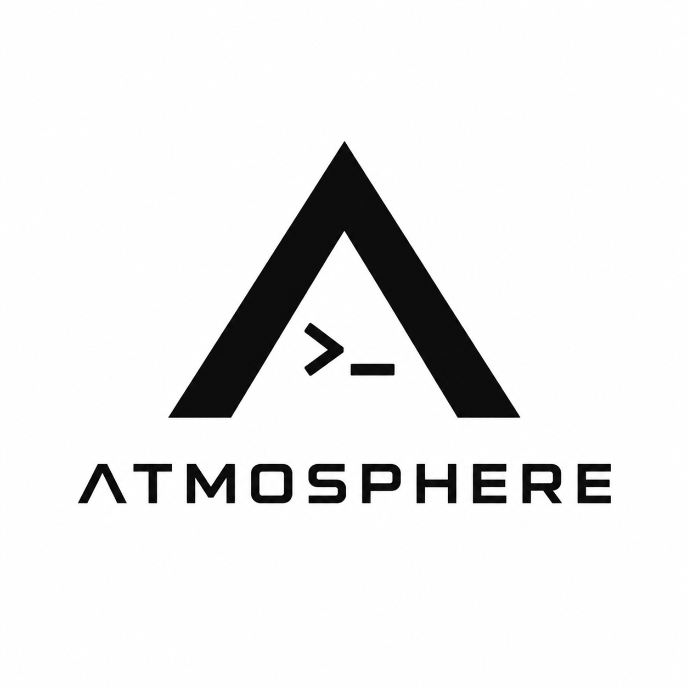

<div align="center">
  <table border="0" cellspacing="0" cellpadding="0">
    <tr>
      <td width="150" align="center" valign="middle" style="border:0;">
        
      </td>
      <td align="left" valign="middle" style="border:0;">
        <h1>ATMOSPHERE-PANEL</h1>
        <p>克制、可靠、可扩展的 Minecraft 服务端控制面板。</p>
      </td>
    </tr>
  </table>
</div>
<p align="center">
  <!-- HTML5 -->
  <a href="https://developer.mozilla.org/en-US/docs/Web/HTML" target="_blank"></a>
  <!-- Vue.js -->
  <a href="https://vuejs.org/" target="_blank"></a>
  <!-- Tailwind CSS -->
  <a href="https://tailwindcss.com/" target="_blank"></a>
  <!-- Nuxt.js -->
  <a href="https://nuxt.com/" target="_blank"></a>
  <!-- TypeScript -->
  <a href="https://www.typescriptlang.org/" target="_blank"></a>
  <!-- Python -->
  <a href="https://www.python.org/" target="_blank"></a>
  <!-- FastAPI -->
  <a href="https://fastapi.tiangolo.com/" target="_blank"></a>
  <!-- SQLite -->
  <a href="https://www.sqlite.org/" target="_blank"></a>
  <!-- bcrypt -->
  <a href="https://github.com/pyca/bcrypt" target="_blank"></a>
  <!-- License -->
  <a href="https://opensource.org/licenses/MIT" target="_blank"></a>
</p>

## 概要

ATMOSPHERE-PANEL 是一个基于 Web 的 Minecraft 服务器管理面板。通过受身份验证保护的界面，您可以进行服务器实例的注册、服务器核心与版本的选择，以及利用后端 API 部署服务器文件

项目由两个部分组成：

- `frontend/` — 基于 Nuxt 的 Web 界面
- `backend/` — 具备 SQLite 存储和部署 API 的 FastAPI 服务

## 快速开始

### Linux 一键部署（推荐）

```bash
wget -qO install.sh https://raw.githubusercontent.com/MiryexOvO/ATMOSPHERE-Panel/main/install.sh
sudo bash install.sh
```

脚本会交互式询问安装路径和端口，自动完成依赖、Python 虚拟环境、Nuxt 构建和 systemd 注册。

### 手动部署

```bash
# 1.进入项目文件夹
cd backend

# 2.创建虚拟环境
python3 -m venv .venv

# 3.激活虚拟环境
source .venv/bin/activate  # Windows 用户请使用: .venv\Scripts\activate

# 4.安装依赖
pip install -r requirements.txt

# 5.启动开发服务器
uvicorn app.main:app --host 0.0.0.0 --port 27777 --reload
```

## 前端开发（[Nuxt 4.6.2](https://nuxt.com/docs/getting-started/introduction)）

```bash
# 1.进入项目文件夹
cd frontend

# 2.安装依赖（以下皆以 npm 为例）
npm install

# 3.启动开发服务器
npm run dev

# 4.部署到生产环境
npm run build

# 5.本地预览正式版本
npm run preview
```

默认面板端口：`27777` 可配置项  
访问 `http://127.0.0.1:5173`。当前 Nuxt 使用客户端渲染，API 通过 `/api` 代理到 FastAPI `27777`  
首次启动时，终端只打印一次 20 位初始密码

## 特性

- 管理实例 ID 和端口的 Minecraft 服务器实例管理
- 支持多款 Java 版、基岩版及 MCDR 核心与版本选择
- 支持 `.zip` 和 `.tar.gz` 格式的服务器核心及 Modpack 压缩包处理
- 检查路径遍历和危险文件的安全压缩包解压
- 部署时的 Java 版本与 JVM 内存设置
- 针对部分资源提供官方资源参考与镜像设置
- 基于 SQLite 的本地数据存储

## 核心能力

- bcrypt 登录与 HttpOnly Session
- Nuxt 4 + Vue 3 + TypeScript 控制台
- 仪表盘、实例概览、CPU / 内存监控
- SSE 控制台、文件、备份和路径安全
- 快速部署、基岩版、上传整合包、MCDR
- ZIP / TAR.GZ / TGZ 安全解压与核心检测

## 服务管理

```bash
sudo systemctl status atmosphere-panel.service
sudo systemctl restart atmosphere-panel.service
sudo journalctl -u atmosphere-panel.service -f
```

## 提示

- 本版本消息:此版本还无法正常使用 预计0.2版本可正常使用所有功能^ ^

- windows,启动脚本仅供跨平台开发使用

- 初始密码只在首次初始化时输出

## 开发检查

```bash
cd frontend && npm run build
cd ../backend && find app -name "*.py" -print0 | xargs -0 -n1 python3 -m py_compile
```

## 许可证

本项目采用 [MIT License](LICENSE)。

## 维护与支持

Maintained by [Miryex](https://www.astrelia7.com)
