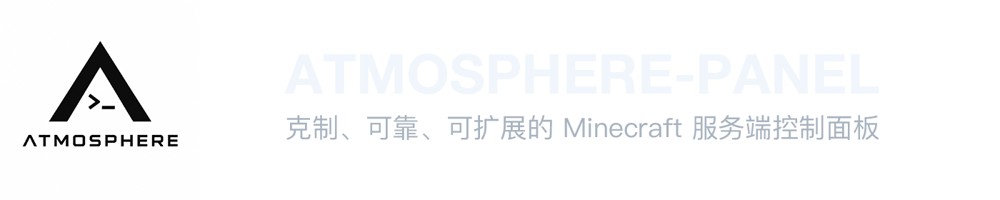

<p align="center">
  <picture>
    <source media="(prefers-color-scheme: dark)" srcset="header-dark.png">
    <source media="(prefers-color-scheme: light)" srcset="header-light.png">
    
  </picture>
</p>

<p align="center">
  <!-- HTML5 -->
  <a href="https://developer.mozilla.org/en-US/docs/Web/HTML" target="_blank"></a>
  <!-- Vue.js -->
  <a href="https://vuejs.org/" target="_blank"></a>
  <!-- Tailwind CSS -->
  <a href="https://tailwindcss.com/" target="_blank"></a>
  <!-- Nuxt.js -->
  <a href="https://nuxt.com/" target="_blank"></a>
  <!-- TypeScript -->
  <a href="https://www.typescriptlang.org/" target="_blank"></a>
  <!-- Python -->
  <a href="https://www.python.org/" target="_blank"></a>
  <!-- FastAPI -->
  <a href="https://fastapi.tiangolo.com/" target="_blank"></a>
  <!-- SQLite -->
  <a href="https://www.sqlite.org/" target="_blank"></a>
  <!-- bcrypt（Shields.io uses a generic Security badge instead） -->
  <a href="https://github.com/pyca/bcrypt" target="_blank"></a>
  <!-- License -->
  <a href="https://opensource.org/licenses/MIT" target="_blank"></a>
</p>

<p align="center">
  English | <a href="./README.md">简体中文</a> | <a href="README_JP.md">日本語</a>
</p>

## Overview

ATMOSPHERE-PANEL is a web-based Minecraft server management panel. Through an authentication-protected interface, you can register server instances, select server cores and versions, and deploy server files using the backend API.

The project consists of two parts:

- `frontend/` — Nuxt-based web interface
- `backend/` — FastAPI service with SQLite storage and deployment API

## Features

- Authentication using secure password hashing and session cookies
- Minecraft server instance management with instance IDs and port management
- Selection of multiple Java Edition, Bedrock Edition, and MCDR cores and versions
- Support for processing server core and Modpack archives in `.zip` and `.tar.gz` formats
- Secure archive extraction with path traversal and dangerous file checks
- Java version and JVM memory settings during deployment
- Official resource references and mirror settings for selected resources
- Local data storage based on SQLite

## Quick Start

Clone the repository
  ```bash
  git clone https://github.com/MiryexOvO/ATMOSPHERE-Panel.git
  ```

## Frontend Development ([Nuxt 4.6.2](https://nuxt.com/docs/getting-started/introduction))

```bash
# 1. Enter the project directory
cd frontend

# 2. Install dependencies (npm is used as an example below)
npm install

# 3. Start the development server
npm run dev

# 4. Deploy to production
npm run build

# 5. Preview the production version locally
npm run preview
```

Default panel port: `27777`, configurable  
Visit `http://127.0.0.1:5173`. Nuxt currently uses client-side rendering, and the API is proxied to FastAPI `27777` through `/api`  
On the first startup, the terminal prints the 20-character initial password only once

## Backend Development ([FastAPI](https://fastapi.tiangolo.com/))


### One-click Linux Deployment (Recommended)

```bash
wget -qO install.sh https://raw.githubusercontent.com/MiryexOvO/ATMOSPHERE-Panel/main/install.sh
sudo bash install.sh
```

The script interactively asks for the installation path and port, then automatically completes dependency installation, Python virtual environment creation, Nuxt build, and systemd registration.

### Manual Linux Deployment

```bash
# 1. Enter the project directory
cd backend

# 2. Create a virtual environment
python3 -m venv .venv

# 3. Activate the virtual environment
source .venv/bin/activate  # Windows users should use: .venv\Scripts\activate

# 4. Install dependencies
pip install -r requirements.txt

# 5. Start the development server
uvicorn app.main:app --host 0.0.0.0 --port 27777 --reload
```

### Windows

```powershell
# 1. Enter the project directory
cd backend

# 2. Temporarily allow script execution for the current session (to avoid permission errors)
Set-ExecutionPolicy -Scope Process Bypass

# 3. Run the Windows startup script
.\run_windows.ps1
```

Do not use the Linux command `.venv/bin/activate`; the Windows virtual environment entry point is `.venv\\Scripts\\python.exe`  
If the system pip for Python 3.14 is damaged, it is recommended to use Python 3.12 or 3.13 to create the virtual environment

## Service Management

```bash
sudo systemctl status atmosphere-panel.service
sudo systemctl restart atmosphere-panel.service
sudo journalctl -u atmosphere-panel.service -f
```

## Notes

- Version notice: This version is not yet fully functional. It is expected that all features will work properly in version 0.2 ^ ^
- The Windows startup script is intended only for cross-platform development
- The initial password is output only during the first initialization

## Development Checks

```bash
cd frontend && npm run build
cd ../backend && find app -name "*.py" -print0 | xargs -0 -n1 python3 -m py_compile
```

## License

This project is licensed under the [MIT License](LICENSE)

## Maintenance and Support

Maintained by [Miryex](https://www.astrelia7.com)
