<p align="center">
  <picture>
    <source media="(prefers-color-scheme: dark)" srcset="header/header-dark-jp.png">
    <source media="(prefers-color-scheme: light)" srcset="header/header-light-jp.png">
    
  </picture>
</p>

<p align="center">
  <!-- HTML5 -->
  <a href="https://developer.mozilla.org/en-US/docs/Web/HTML" target="_blank"></a>
  <!-- Vue.js -->
  <a href="https://vuejs.org/" target="_blank"></a>
  <!-- Tailwind CSS -->
  <a href="https://tailwindcss.com/" target="_blank"></a>
  <!-- Nuxt.js -->
  <a href="https://nuxt.com/" target="_blank"></a>
  <!-- TypeScript -->
  <a href="https://www.typescriptlang.org/" target="_blank"></a>
  <!-- Python -->
  <a href="https://www.python.org/" target="_blank"></a>
  <!-- FastAPI -->
  <a href="https://fastapi.tiangolo.com/" target="_blank"></a>
  <!-- SQLite -->
  <a href="https://www.sqlite.org/" target="_blank"></a>
  <!-- bcrypt（Shields.io uses a generic Security badge instead） -->
  <a href="https://github.com/pyca/bcrypt" target="_blank"></a>
  <!-- License -->
  <a href="https://opensource.org/licenses/MIT" target="_blank"></a>
</p>

<p align="center">
  <a href="./README_EN.md">English</a> | <a href="./README.md">简体中文</a> | 日本語
</p>

## 概要

ATMOSPHERE-PANEL は、Web ベースの Minecraft サーバー管理パネルです。認証で保護されたインターフェースを通じて、サーバーインスタンスの登録、サーバーコアとバージョンの選択、バックエンド API を利用したサーバーファイルのデプロイを行えます。

プロジェクトは次の 2 つの部分で構成されています。

- `frontend/` — Nuxt ベースの Web インターフェース
- `backend/` — SQLite ストレージとデプロイ API を備えた FastAPI サービス

## 機能

- 安全なパスワードハッシュとセッション Cookie を使用した認証機能
- インスタンス ID とポートを管理する Minecraft サーバーインスタンス管理
- 複数の Java 版、Bedrock 版、MCDR のコアとバージョンの選択に対応
- `.zip` および `.tar.gz` 形式のサーバーコアと Modpack アーカイブの処理に対応
- パストラバーサルと危険なファイルを検査する安全なアーカイブ展開
- デプロイ時の Java バージョンと JVM メモリ設定
- 一部のリソースに対する公式リソース参照とミラー設定
- SQLite に基づくローカルデータストレージ

## クイックスタート

リポジトリをクローンします
  ```bash
  git clone https://github.com/MiryexOvO/ATMOSPHERE-Panel.git
  ```

## フロントエンド開発（[Nuxt 4.6.2](https://nuxt.com/docs/getting-started/introduction)）

```bash
# 1. フロントエンドディレクトリに移動
cd frontend

# 2. 依存関係のインストール
pnpm install

# 3. 開発サーバーの起動
pnpm dev

# 4. プロダクションビルドの実行
pnpm build

# 5. 本番環境のローカルプレビュー
pnpm preview
```

デフォルトのパネルポート：`27777`、設定可能  
`http://127.0.0.1:5173` にアクセスしてください。現在 Nuxt はクライアントサイドレンダリングを使用しており、API は `/api` を通じて FastAPI `27777` にプロキシされます  
初回起動時、ターミナルには 20 文字の初期パスワードが一度だけ表示されます

## バックエンド開発（[FastAPI](https://fastapi.tiangolo.com/)）

### Linux ワンクリックデプロイ（推奨）

```bash
# Debian / Ubuntu
apt update && sudo apt install -y wget

# Red Hat / Fedora
yum install -y wget

# Arch Linux
pacman -Syu --noconfirm wget

# インストールスクリプトのダウンロード
wget -qO install.sh https://raw.githubusercontent.com/MiryexOvO/ATMOSPHERE-Panel/main/install.sh

# ミラーサイトもご利用いただけます
wget -qO install.sh https://gh-proxy.com/https://raw.githubusercontent.com/Miryex0v0/ATMOSPHERE-Panel/main/install.sh

# 権限を付与してインストールを実行
bash install.sh
```

スクリプトはインストールパスとポートを対話形式で確認し、依存関係、Python 仮想環境、Nuxt のビルド、systemd への登録を自動的に完了します。

### Linux 手動デプロイ

```bash
# 1. プロジェクトフォルダに移動
cd backend

# 2. 仮想環境を作成
python3 -m venv .venv

# 3. 仮想環境を有効化
source .venv/bin/activate  # Windows ユーザーは .venv\Scripts\activate を使用してください

# 4. 依存関係をインストール
pip install -r requirements.txt

# 5. 開発サーバーを起動
uvicorn app.main:app --host 0.0.0.0 --port 27777 --reload
```

### Windows

```powershell
# 1. プロジェクトフォルダに移動
cd backend

# 2. 現在のセッションでスクリプトの実行を一時的に許可（権限エラーを回避するため）
Set-ExecutionPolicy -Scope Process Bypass

# 3. Windows 起動スクリプトを実行
.\run_windows.ps1
```

Linux コマンド `.venv/bin/activate` は使用しないでください。Windows の仮想環境のエントリーポイントは `.venv\\Scripts\\python.exe` です  
Python 3.14 のシステム pip が壊れている場合は、Python 3.12 または 3.13 を使用して仮想環境を作成することをおすすめします

## サービス管理

```bash
# 1. atmosphere-panel サービスの現在の稼働状態（実行中か、エラーの有無、起動ログなど）を確認する
sudo systemctl status atmosphere-panel.service

# 2. atmosphere-panel サービスを再起動する（バックエンドのコードや設定ファイルを変更した後、変更を反映させるために実行）
sudo systemctl restart atmosphere-panel.service

# 3. atmosphere-panel サービスの実行ログをリアルタイムで追跡・表示する（-f は follow の略で、エラーの切り分けやデバッグに便利）
sudo journalctl -u atmosphere-panel.service -f
```

## 注意事項

- バージョンに関するお知らせ：このバージョンはまだ正常に使用できません。すべての機能が正常に使用できるようになるのは 0.2 版の予定です ^ ^
- Windows 起動スクリプトはクロスプラットフォーム開発専用です
- 初期パスワードは初回の初期化時にのみ出力されます

## 開発チェック

```bash
cd frontend && npm run build
cd ../backend && find app -name "*.py" -print0 | xargs -0 -n1 python3 -m py_compile
```

## ライセンス

このプロジェクトは [MIT License](LICENSE) を採用しています

## メンテナンスとサポート

Maintained by [Miryex](https://www.astrelia7.com)
